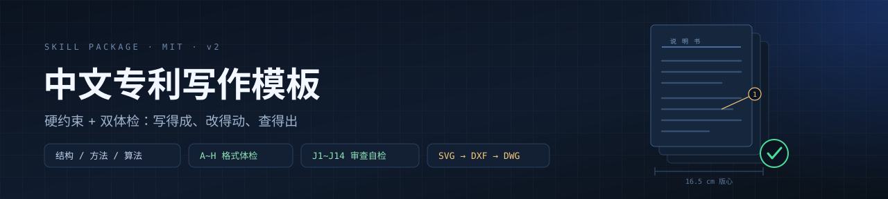
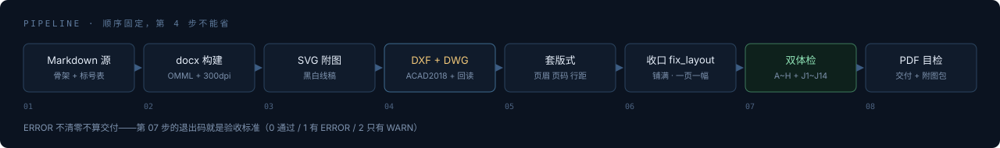

<p align="center">
  
</p>

<p align="center">
  <a href="LICENSE"></a>
  
  
  
  
  
</p>

# 中文专利写作模板 Skill

> 把一份**真实提交过、且已授权**的中文专利申请，连同它的结构顺序、句式、标号体系、附图规范、
> 页面版式，一起固化成一个可执行的 AI 技能包。
>
> 不是「提示词大全」，是**硬约束 + 可验证脚本**：每条规则都能被 `audit_patent.py` 抓出来，
> 改到零 ERROR 才算过。

写给谁：**手里有技术方案，但没写过专利的工程师、算法同学、硬件/结构设计师、独立开发者。**
你不需要背《审查指南》，只需要把东西讲清楚，剩下的格式、标号、版式、附图、驳回风险，脚本兜。

---

## 它解决什么问题

AI 写专利，翻车的地方从来不是「写得不像专利」。真正让代理所返工、让审查员发通知书的是这些：

| 你会遇到的症状 | 谁抓它 |
|---|---|
| 页眉横线一会儿有一会儿没（Word 内置样式根本不生效） | `--report` 查 `w:pBdr` |
| 标号跳号、子件不继承父号、正文和图对不上 | A~H 的 D/E |
| 公式是截图，代理所改一个字都要重画 | H（数 OMML 对象） |
| 具体实施方式里满地小标题，读起来像 PPT | F |
| 附图有中文、有灰度、有装饰色，或者只有版心 74% 宽、标号挤成一团 | 4.2 + `fix_layout.py` |
| 摘要写了 414 字（上限 300） | J6 |
| 有附图，却没有那页「摘要附图」 | **L1**（指南 4.5.2：单独一页，且取说明书附图中的一幅） |
| 权项引用了在自己后面的权项，多项从权引多项 | J2 / J3 |
| 写「内径 106 mm」，但同一篇里规格是 φ114×6（内径应为 102） | **J9** |
| 效果写「显著提升」，全文找不到一个数字 | J8 |
| 方法专利的步骤（2）~（6）在说明书里根本没展开 | **K5** |
| 要 DWG，转出来打开是空白 / 中望报「图形已损坏」 | `svg2dwg.py` 回读校验 |

**写作有一遍流程，改稿有一遍体检，交付前必过两道闸。** 这就是全部设计。

### 它不是提示词，是四件东西

| 提示词会告诉你 | 这个技能给你 |
|---|---|
| 「用宋体 12 pt、固定行距 23 pt」 | `apply_patent_format.py`——直接写进 docx 的 XML，跑完就是对的 |
| 「附图要规范」 | `svg2dwg.py`——SVG → DXF → DWG(ACAD2018)，自动分层、自动把 pattern 剖面线展开成真线、转完再反向读回来比对 |
| 「注意别被驳回」 | `audit_exam_risk.py`——14 条 J 类检查，每条挂具体法条，带退出码 |
| 「按模板结构写」 | `SKILL.md` 十三章 + 句式库，写的时候就有约束，不用写完再猜 |

---

## 能写哪些专利

**结构类、方法类、算法类、系统类**（含工艺、控制、软件、机电一体）都走同一套骨架：
摘要 → **摘要附图** → 权项 → 说明书 → 附图，页面版式与两套体检完全一致，只换四样东西——
主题词、独权引导语、标号有无、附图类型。

| 类型 | 独立权利要求长什么样 | 附图 | 该类型专属的坑 |
|---|---|---|---|
| **结构 / 装置** | `一种XX，其特征在于，所述装置包括：A、B以及C；` | 外形 / 剖面 / 结构 / 原理图 | 标号体系；尺寸自洽（J9/J10） |
| **方法 / 工艺** | `一种XX方法，其特征在于，包括以下步骤：`<br>`步骤（1）……；步骤（2）……；` | 图1 必须流程图 | 步骤编号只能一种风格且 1..N 连续；每步都要在实施方式展开（K1/K2/K5） |
| **算法 / 软件** | `一种XX方法，其特征在于，包括：获取……；输入……；根据……确定……；` | 流程图 + 框图 + 效果曲线 | **法 25 条客体**：必须写成解决技术问题的技术方案；必须补「电子设备 / 存储介质」载体权项（K4） |
| **系统 / 控制** | `一种XX系统，其特征在于，包括：A模块、B模块；所述A模块用于……` | 系统框图 | 模块必须能在说明书逐一找到实现（J12） |

细节（权项模板、客体三句话、流程图文字例外规则）全在
**[`references/patent_types.md`](references/patent_types.md)**。
`audit_patent.py` 会自己判型，打印 `[K] 判型：方法类`，结构类自动跳过 K 类检查。

<p align="center">
  
</p>

<p align="center"><sub>八步管线。第 4 步（出 DWG）与第 7 步（双体检）跳过，都不能算交付——<b>ERROR 不清零就是没做完</b>。</sub></p>

---

## 实测输出

结构类（16 页、3 实施例、5 图、49 个 OMML 公式）。下面是 2026-10-21 加完 L 类（摘要附图）检查后，
回头跑一份**已交付稿子**的真实结果：

```text
$ python scripts/audit_patent.py 专利.docx
======================================================================
段落 116 段、表格 0 张、公式 49 个
======================================================================
  ✓ [分册] 按页眉册名还原 4 册：权利要求书/说明书摘要/说明书/说明书附图
  ✓ [C] 权项 16 项，编号 1..16 连续
  ✓ [K] 判型：结构类（按权项 1 主题词判定）
  ✓ [D] 标号 11 个：父 7、子 4
  ✓ [F] 具体实施方式内无小标题
  ✓ [G] 实施例 3 个、表格 0 张
  ✓ [H] OMML 可编辑公式 49 个
  ✗ [L1] 全文有附图，但缺「摘要附图」册：有附图须提交一幅最能说明技术方案的
    附图作为摘要附图，单独一页，排在说明书摘要之后、权利要求书之前（指南 4.5.2）
----------------------------------------------------------------------
结论：✗ 1 处 ERROR、0 处 WARN —— 必须改
```

格式全对、内容也没毛病，但**少了一册**。四册模板一直漏着「摘要附图」，人读稿子几乎不会注意——
这正是把它做成脚本检查的理由。

注意 `[分册]` 那行：套过版式的成品稿，册名已经移进页眉，正文里没有「权利要求书」这行字。
脚本按 `sectPr` 分节 + 页眉册名反推册边界——**不这么做的体检工具会跳过权项检查还报"全部通过"**。

```text
$ python scripts/audit_exam_risk.py 专利.docx
  ✓ [J1] 独立权项 [1, 2, 3] 均含「其特征在于」
  ✓ [J2] 从权 13 项，引用指向均在前
  ✓ [J6] 摘要 262 字（≤300）
  ✓ [J9] 内径校验通过：文中内径值均来自 φ 规格反推 [44.0, 102.0] mm
  ✓ [J11] 以「本发明的目的在于…」表述发明目的
  ✓ [J12] 独立权项的技术名词均能在说明书找到对应记载
  ✓ [J14] 权项数值范围端点均能在说明书找到
----------------------------------------------------------------------
结论：✅ 通过（J 类风险扫描）
```

同一套脚本跑一份方法类初稿，当场抓出真问题（不是格式，是内容）：

```text
$ python scripts/audit_patent.py 制备方法.docx
  ✓ [K] 判型：方法类（按权项 1 主题词判定）
  ✓ [D] 方法/算法类未使用附图标记（允许）
  ✓ [K1] 方法权项引导语「包括以下步骤」✔
  ✓ [K2] 步骤编号「步骤（1）」..「步骤（6）」连续
  ⚠ [B] 禁用词「本申请」出现 9 次（应统一为「本发明」）
  ⚠ [G] 表格 3 张（规范：0~1 张，优先 0）
  ⚠ [H] 未发现 OMML 公式对象（若正文有公式，说明没转成可编辑对象）
  ✗ [G] 实施例 8 个（上限 3）
  ✗ [K5] 权项步骤 [2, 3, 4, 5, 6] 未在具体实施方式中逐条展开
----------------------------------------------------------------------
结论：✗ 2 处 ERROR、3 处 WARN —— 必须改
```

K5 那句是真问题：权项写了六个步骤，说明书里只展开到步骤（1），后面五步全是空的。
这类缺陷靠人读很难发现——权项看着完整、页数也够，但它直接踩法 26.3 公开不充分。

---

## 装

技能目录的规则很简单：**一个文件夹 = 一个技能**。

```bash
# WorkBuddy
git clone https://github.com/lianghugjil/patent-template.git \
  ~/.workbuddy/skills/patent-template

# Claude Code
git clone https://github.com/lianghugjil/patent-template.git \
  ~/.claude/skills/patent-template
```

Windows 用户直接把仓库放进 `C:\Users\<你>\.workbuddy\skills\patent-template\` 也行。

依赖：

```bash
pip install python-docx ezdxf          # 版式、体检、附图转换
```

| 能力 | 需要什么 | 缺了会怎样 |
|---|---|---|
| 写、改、体检 docx | Python 3.9+ / `python-docx` | 寸步难行 |
| 附图 → DXF | `ezdxf` | 只能出 SVG |
| 附图 → DWG | **ODA File Converter** | `--dxf-only` 降级；装法见 `references/dwg_export.md` §0-A（免安装拆包法，全程命令行） |

---

## 用

### 一、写新专利

```text
按我的模板写一篇专利，主题是 XXX，交底材料在 交底.docx
```

技能会先给你**骨架 + 标号体系表**让你确认（这一步别跳，标号定错后面全乱），再写正文，
最后走完管线：docx → 附图 DXF+DWG → 套版式 → 收口 → 双体检 → PDF。
**附图的可编辑 DWG 是默认交付物，不用另外开口要。**

### 二、改已有专利 / 被退回的稿子

```text
用 patent-template 技能体检这份 docx，列出所有不合规项，先别改
```

```bash
python scripts/audit_patent.py 专利.docx            # 格式 A~H + 类型适配 K + 摘要附图 L
python scripts/audit_exam_risk.py 专利.docx         # 实质风险 J1~J14
python scripts/apply_patent_format.py 专利.docx     # 套版式
python scripts/fix_layout.py 专利.docx              # 收口：行距 + 附图铺满 + 一页一幅
python scripts/apply_patent_format.py 专利.docx --report   # 版式体检，缺横线/标题没居中都会报
```

铁律是 **先体检 → 只改一类 → 复跑体检**。一上来通读全文重写，公式和图一定废。
有同名 `.md` 源就改源再重建；只有 docx 时才直接改 docx（`python-docx` 会把 OMML 公式改坏）。

### 三、只要附图（能在 CAD 里改）

```bash
python scripts/svg2dwg.py 附图/*.svg --out 说明书附图
# 附图1_结构示意图.dxf + 同名 .dwg（ACAD2018），每张自动回读比对实体/文字/图层
```

脚本会**自动把 `<pattern>` 剖面线展开成真平行线、把 `<marker>` 箭头展开成三角实体**——
CAD 不认这两种 SVG 写法，不展开就是静默丢失，甚至被画成一块黑。
按线宽自动分图层（`OUTLINE` / `HATCH` / `CENTER` / `LEADER` / `LABEL`），文字统一 `GB` 样式
（`gbenor.shx` + `gbcbig.shx`），中文直接进 CAD 不是方块。

---

## 交付长什么样

```text
outputs/
├── 专利申请_XXX_2026-10-21.docx         # 16 页、4 节、页眉册名、页码每册从 1 起
├── 专利申请_XXX_2026-10-21.md           # 源文件（公式与附图都在这里，改稿改它）
├── 专利申请_XXX_2026-10-21.pdf          # 目检用
├── 说明书附图/
│   ├── 附图1_总体结构示意图.svg / .dxf / .dwg
│   └── 附图2_剖面图.svg / .dxf / .dwg
└── 专利附图_DXF_DWG可编辑_2026-10-21.zip
```

---

## 规范不是拍脑袋定的

全部从**同一申请人的 20 篇已提交/已授权中文专利 docx 原文**逐项实测提取：章节顺序、句式、
标号习惯、页边距 twips 级数值、行距、字号、附图宽度，都是量出来的，不是设计出来的。

| 项 | 实测值 |
|---|---|
| 页边距 | A4；上 2.5 / 下 2.0 / 左 2.5 / 右 2.0 cm（左右不对称，左宽右窄） |
| 页眉 | 黑体 16 pt 居中，内容是册名（`说　明　书` 全角空格隔开），**下方 0.75 pt 横线** |
| 页脚 | 宋体 12 pt 居中页码，**无横线**，每册从 1 重新起 |
| 正文 | 宋体 12 pt（西文 Times New Roman），**固定行距 23 pt**，首行缩进 2 字符，段间不空行 |
| 附图 | 铺满版心 **16.5 cm**，第 2 张起各占一页 |
| 结构 | 摘要 → 摘要附图 → 权项 → 说明书（名称/领域/背景/内容/附图说明/实施方式）→ 附图；实施例 ≤3，表格 0~1 张 |

> 想改成自己单位的模板？只改 `references/docx_format.md` 与 `apply_patent_format.py`
> 顶部那几个 `M_TOP / M_BOT / M_LEFT / M_RIGHT`，其余章节不用动。

---

## 几条最值钱的规范

- **页眉横线**：Word 内置 `Header` 样式自带的下边框不会自动生效。必须往页眉段落 `pPr` 里写
  `w:pBdr`，只给 `bottom` 一条（`single` / `sz=6` / `space=1`），其余五边 `nil`；页脚六边全 `nil`。
- **标题居中**：左右边距不对称时，Word 的「居中」落在**版心**中心、比纸心偏右 0.25 cm。
  发明名称要在段落里补 `w:ind left=-142 right=142` 才对得上纸张中心——页眉册名、页脚页码同轴处理。
- **标号**：父件 1、2、3… 严格连续；子件继承父号（101/102/103），同级连续不跳号；
  名称与数字紧贴（`主壳体1`，不是 `主壳体 1` / `主壳体(1)`）；权项与发明内容里不带标号。
- **具体实施方式不设小标题**：全篇唯一允许的小标题是 `【实施例一】`。结构、参数、公式全部用
  自然段落承接（「结合图1所示……」→「其中，……」→「为使上述结构……」）。
- **公式必须是 OMML**：`$f_0$`、`$L_{\mathrm{eff}}$` 走转换器。别直接打 Unicode 下标（宋体缺字形，
  Word 里显示成方框），也别写裸 `L_eff`（会被当斜体标记吞掉下划线）。
- **DWG 只能用 ODA File Converter 转**（输出 ACAD2018）。LibreDWG 的 `dxf2dwg` 写出来的文件
  **能被它自己读回、但中望打开报「图形包含不正确或已损坏的信息」**——典型的自洽型假阳性。
  LibreDWG 只留作只读校验器。
- **审查弹药只能写稿时埋**：意料不到的效果、非线性跃变、克服技术偏见、多重效果协同。
  答复阶段再加进说明书，就是法 33 条超范围。

---

## FAQ

**Q：一定要装 ODA 才能出 DWG 吗？**
是。ODA File Converter 是唯一能稳定产出合规 DWG 的免费方案，`references/dwg_export.md` §0-A
给了免安装拆包法（全程命令行，不用点 MSI 向导）。实在装不上就 `--dxf-only`，代理所也能用。

**Q：会把我还没申请的技术方案传到网上吗？**
不会。所有脚本纯本地跑，读写你磁盘上的文件，没有网络请求。仓库里也**不包含任何真实专利文本**。

**Q：能写实用新型吗？**
能。实用新型没有实质审查，但**格式、标号、附图要求与发明完全一致**——生产线上量产的图上标号
乱跳，一样会被补正。算法类不能申请实用新型，这条得先判型。

**Q：我只有交底材料 / 一段代码 / 一张草图，能起稿吗？**
能。交底材料是 `docx / md / pdf / 截图` 都行，技能会先把它拆成「技术问题 → 技术手段 → 技术效果」
三栏，缺哪栏会直接问你，而不是替你编。

**Q：审计脚本会不会误报？**
会有误报，而且**宁可多报也不漏报**。J 类是风险扫描不是审查结论：ERROR 是硬矛盾（不改必被指出），
WARN 是「审查员很可能发问、而答复时你手里没牌」。WARN 要逐条给判断，不许假装没看见——
这条写在 SKILL.md 里。

**Q：能改我自己单位的模板吗？**
改第七章 + `references/docx_format.md` 的数值即可，其余不必动。

---

## 不包含什么

- **不含任何专利文本**。语料摘要与抽取脚本已剔除，仓库里没有一件具体技术方案。
- 不含申请人、发明人、代理机构信息。
- 不构成法律意见。权利要求能不能授权，取决于技术方案本身与检索结果；
  创造性有无对比文件、单一性、客体这些问题无法形式化，见 `references/exam_risks.md` 的人工清单。

---

## 文件清单

| 文件 | 作用 |
|---|---|
| `SKILL.md` | 十三章硬规范：结构顺序、句式库、标号规则、附图规范、权项风格、公式、版式、语言红线、管线、自查清单、改稿模式、审查自检、方法/算法适配 |
| `references/docx_format.md` | 版式数值表（twips 级）+ 页眉页脚 XML 片段 + 验收清单 |
| `references/drawing_spec.md` | 附图线宽表、45° 剖面线算法、箭头算法、SVG 模板 |
| `references/dwg_export.md` | DXF/DWG 完整管线、ODA 便携部署、校验口径 |
| `references/exam_risks.md` | 法 2.2 / 22.3 / 25 / 26.3 / 26.4 / 31.1 / 33 与细则 21~23 的问法 + 答复弹药清单 |
| `references/patent_types.md` | **结构 / 方法 / 算法 / 系统 四类的骨架映射、权项模板、附图文字例外规则** |
| `scripts/apply_patent_format.py` | 一键套版式：切节 + 页眉 + 页脚 + 字体 + 23 pt 行距 + 标题居中；`--report` 体检 |
| `scripts/fix_layout.py` | 收口：行距收紧、附图铺满版心、第 2 张起一页一幅（幂等） |
| `scripts/audit_patent.py` | 格式体检 A~H + 类型适配 K1~K5 + 摘要附图 L1~L3，退出码 0/1/2 |
| `scripts/audit_exam_risk.py` | 审查避坑自检 J1~J14，docx 与 md 都能读 |
| `scripts/svg2dwg.py` | SVG → DXF → DWG(ACAD2018) + 反向回读校验，一条命令 |

## License

MIT，见 [LICENSE](LICENSE)。
